# 🌟 VitrinOS

VitrinOS, e-ticaret markaları için yapay zeka destekli, otomatik pazarlama görselleri (Banner, Meta Post, Story) ve reklam metinleri üreten, uçtan uca yapılandırılmış modern bir görsel otomasyon platformudur. 

Sistem; temiz bir web arayüzü (Vanilla HTML/CSS/JS), güçlü bir ilişkisel veritabanı (Supabase) ve esnek bir yapay zeka orkestrasyon motorunu (n8n & OpenAI DALL-E / GPT) bir araya getirir.

---

## 📐 Sistem Mimarisi ve İş Akışı

Sistemin temel çalışma mantığı ve veri akışı aşağıdaki şemada özetlenmiştir:

```mermaid
graph TD
    A[Müşteri / Dashboard] -->|1. Brief & Format Gönder| B[n8n Webhook / VitrinOS_BASE]
    B -->|2. Marka & Prompt Bilgisi Sorgula| C[(Supabase Database)]
    C -->|3. Kurallar & Şablonlar| B
    B -->|4. Brief Analizi & Filtreleme| D[LLM Brief Analiz Ajanı]
    D -->|5. Yapılandırılmış JSON Çıktısı| B
    B -->|6. Format Router| E{Görsel Formatı?}
    
    E -->|Meta Post| F[VitrinOS_META_POST]
    E -->|Story| G[VitrinOS_STORY]
    E -->|Banner| H[VitrinOS_BANNER]
    E -->|Revizyon| I[VitrinOS_REVIZE]
    
    F & G & H & I -->|7. Görsel ve Metin Üretimi| J[OpenAI DALL-E & GPT]
    J -->|8. Logo Ekleme & Boyutlandırma| K[Jimp Image Engine]
    K -->|9. Nihai Görseli Storage'a Yükle| L[(Supabase Storage)]
    L -->|10. URL & Durum Güncelle| C
    C -->|11. Gerçek Zamanlı Bildirim| A
```



---

## 🛠️ Teknolojik Altyapı

### 1. Frontend (Web Arayüzü)
Platform, hafif ve hızlı olması amacıyla harici framework bağımlılığı olmadan **Vanilla HTML, CSS ve JavaScript** ile geliştirilmiştir. Google Fonts (Inter vb.) ve dinamik karanlık/aydınlık mod uyumlu HSL renk şemaları kullanılmıştır.
* **[index.html](file:///c:/Users/Mustafa/Desktop/VitrinOS/index.html):** Tanıtım sayfası ve potansiyel müşteri adaylarının form gönderebileceği lead toplama alanı.
* **[login.html](file:///c:/Users/Mustafa/Desktop/VitrinOS/login.html):** Güvenli kullanıcı ve yönetici giriş paneli.
* **[dashboard.html](file:///c:/Users/Mustafa/Desktop/VitrinOS/dashboard.html):** Müşterilerin yeni brief tanımlayabildiği, geçmiş işleri takip ettiği, üretilen görselleri ve metinleri görüntüleyip onayladığı ya da revizyon talep ettiği ana kontrol paneli.
* **[admin.html](file:///c:/Users/Mustafa/Desktop/VitrinOS/admin.html):** Yöneticilerin markaları, markalara özel AI prompt şablonlarını yönetebildiği ve tüm iş akışlarını denetleyebildiği yönetim paneli.

### 2. Backend & Veritabanı (Supabase)
Backend hizmetleri, PostgreSQL tabanlı Supabase üzerinde barındırılmaktadır.
* **Brands (`brands`):** Markaların adları, logoları, web siteleri, renk paletleri ve marka ses tonu kuralları (`tone_rules`, `banned_words`) burada saklanır.
* **Brand Prompts (`brand_prompts`):** Her markanın Banner, Meta Post, Story formatları ve revizyon işlemleri için özelleştirilmiş sistem prompt şablonlarını barındırır.
* **Jobs (`jobs`):** Görsel üretim taleplerini (brief, format, durum, üretilen resim URL'si, revizyon notları ve LLM'den dönen normalize JSON) takip eder.
* **Leads (`leads`):** İletişim formu üzerinden gelen müşteri adayı taleplerini saklar.
* **Güvenlik (RLS):** Row Level Security politikaları sıkılaştırılarak kullanıcıların yalnızca kendi markalarına ve işlerine erişmesi, yöneticilerin ise tüm sistemi yönetebilmesi garanti altına alınmıştır.

### 3. Yapay Zeka & Orkestrasyon (n8n)
Sistemin beyni, n8n üzerinde çalışan 5 adet entegre iş akışından oluşmaktadır.

---

## 🤖 n8n İş Akışları (Workflows)

### 1. `VitrinOS_BASE`
Sistemin ana kontrol merkezidir. Dashboard'dan gelen webhook isteklerini karşılar ve yönlendirir.
* **Akış Türü:** Tetikleyici (Webhook - `/vitrinos-brief`).
* **Çalışma Mantığı:**
  1. Gelen isteğin yeni bir brief mi yoksa revizyon isteği mi olduğunu ayırt eder.
  2. Supabase'den ilgili markanın ses tonu ve prompt şablonu verilerini çeker.
  3. **Yeni Brief ise:** `LLM_Brief_Analiz_Ajani` (GPT-4o-mini) kullanarak brief metnini marka kurallarına ve yasaklı kelimelere göre süzgeçten geçirir. Çıktıyı JSON formatına parse eder. `Gorsel_Formati_Router` ile işi alt akışlara (Meta Post, Story, Banner) yönlendirir.
  4. **Revizyon ise:** Revizyon limit kontrolü yapar (Maksimum 3 hak). Limit aşılmadıysa eski görseli indirip `VitrinOS_REVIZE` akışına gönderir.
  5. Alt akışlardan dönen nihai görseli Supabase Storage (`generated-assets`) bucket'ına yükler ve veritabanındaki ilgili işi günceller.

### 2. `VitrinOS_META_POST`
Instagram dikey post (1080x1350) formatında reklam görseli ve metni üretir.
* **Çalışma Mantığı:**
  * **Ürün Resmi Yoksa:** LLM ile taslak görsel promptu üretip sıfırdan konsept reklam tasarımı yapar.
  * **Ürün Resmi Varsa:** Ürün görselini internetten indirir. LLM ile bir stüdyo/arka plan sahne tasarımı promptu hazırlar. DALL-E ile sadece arka planı üretir. Ardından gelişmiş DALL-E inpainting/editing komutları kullanarak gerçek ürünü, üretilen arka plandaki 3D podyumun üzerine ışık, açı ve gölge uyumuyla yerleştirir.
  * **Son Dokunuş:** Görseli Jimp motoru yardımıyla 1080x1350 boyutuna getirir ve markanın logosunu dinamik olarak (belirlenen logo konumuna göre) üzerine yerleştirir. Instagram reklam metnini ve emojili caption'ı üretir.

### 3. `VitrinOS_STORY`
Instagram Story (1080x1920) formatı için özelleştirilmiş dikey reklam şablonları üretir.
* **Çalışma Mantığı:** `VitrinOS_META_POST` ile benzer görsel birleştirme ve inpainting mantığını kullanır; ancak sahne boyutlandırmasını ve logo yerleşimini dikey story (1080x1920) formatına göre optimize eder.

### 4. `VitrinOS_BANNER`
Web siteleri için yatay Banner (1600x600) formatında görsel içerikler hazırlar.
* **Çalışma Mantığı:** Yatay kompozisyon kurallarına uygun olarak ürünü sahneye yerleştirir ve Jimp ile banner boyutlarında kırpıp logoyu ekler.

### 5. `VitrinOS_REVIZE`
Müşterinin dashboard üzerinden ilettiği revizyon notlarına göre mevcut görseli günceller.
* **Çalışma Mantığı:** Orijinal brief'i, eski görseli ve kullanıcının revizyon taleplerini alarak LLM ve DALL-E Image Edit API yardımıyla görsel üzerinde lokal düzeltmeler (renk değişimi, konum kaydırma, arka plan detay güncellemesi vb.) gerçekleştirir.

---

## 📂 Klasör Yapısı

```text
VitrinOS/
├── css/                     # Stil Dosyaları
│   ├── admin.css            # Yönetici paneli özel stilleri
│   ├── dashboard.css        # Müşteri paneli özel stilleri
│   ├── index.css            # Ana tanıtım sayfası stilleri
│   ├── login.css            # Giriş ekranı stilleri
│   └── style.css            # Ortak CSS bileşenleri
├── js/                      # JavaScript Mantığı
│   ├── admin.js             # Yönetici paneli DOM ve API işlemleri
|   |-- config.js            # Supabase istemci ayarlari
│   ├── dashboard.js         # Müşteri paneli DOM ve API işlemleri
│   ├── lead-form.js         # Müşteri adayı formu gönderim tetikleyicisi
│   ├── login.js             # Oturum açma mantığı
│   ├── main.js              # Ortak JS yardımcıları
│   ├── reveal.js            # Görsel geçiş efektleri
│   └── supabase.js          # Supabase SDK sarmalayıcısı ve Auth yönetim kuralları
├── supabase/                # Supabase Yapılandırmaları
|   |-- functions/           # Edge Function kaynaklari
|   `-- migrations/          # SQL Veritabani semalari ve RLS politikalari
├── admin.html               # Yönetici Paneli Arayüzü
├── dashboard.html           # Müşteri Kontrol Paneli Arayüzü
├── index.html               # Ana Sayfa / Landing Page
├── login.html               # Giriş Sayfası Arayüzü
└── .gitignore               # Sürüm Kontrol Dışı Bırakılan Dosyalar
```

---

## 🚀 Başlangıç ve Yerel Kurulum

1. **Gereksinimler:**
   * Modern bir web tarayıcısı.
   * Supabase hesabı (Veritabanı ve Storage yapılandırması için).
   * n8n entegrasyonu (İş akışlarını çalıştırmak için).

2. **Veritabanı Kurulumu:**
   * Supabase projenizde `supabase/migrations` altındaki SQL dosyalarını sırasıyla (veya CLI kullanarak) çalıştırarak tabloları, RLS politikalarını ve `generated-assets` storage bucket'ını oluşturun.

3. **n8n İş Akışlarının Yüklenmesi:**
   * n8n arayüzünde yeni bir workflow oluşturup yukarıda detaylandırılan iş akışlarının JSON şablonlarını import edin. Webhook URL'lerini aktif hale getirin.

4. **Arayüz Yapılandırması:**
   * [js/config.js](file:///c:/Users/Mustafa/Desktop/VitrinOS/js/config.js) dosyasini acarak kendi Supabase URL'nizi ve Publishable Key'inizi girin. n8n webhook URL'sini frontend'e koymayin; Supabase secret olarak tanimlayin:
     ```javascript
     window.VitrinOS.config = {
       supabaseUrl: "https://<PROJE_ID>.supabase.co",
       supabasePublishableKey: "<PUBLISHABLE_KEY>",
       briefTriggerFunction: "trigger-brief",
       // ...
     };
     ```
     ```bash
     supabase secrets set N8N_WEBHOOK_URL="https://<N8N_SUNUCUNUZ>/webhook/vitrinos-brief"
     supabase secrets set N8N_WEBHOOK_SECRET="<N8N_SHARED_SECRET>"
     supabase functions deploy trigger-brief
     ```
     n8n `VitrinOS_BASE` webhook girisinde `x-vitrinos-webhook-secret` header degerini dogrulayin ve eski public webhook path'ini rotate edin.

5. **Çalıştırma:**
   * Projeyi yerelde `python -m http.server 8000` ile baslatip `http://localhost:8000/` adresinden erisebilirsiniz.
