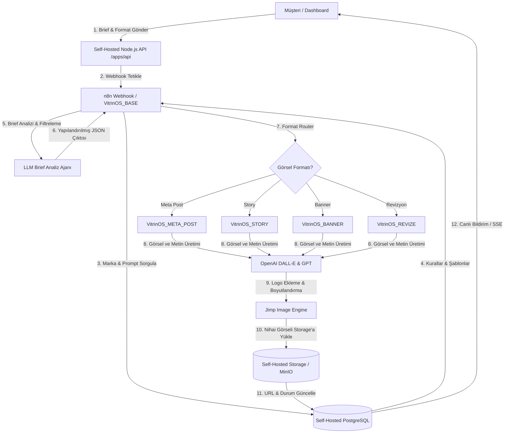

# 🌟 VitrinOS

VitrinOS, e-ticaret markaları için yapay zeka destekli, otomatik pazarlama görselleri (Banner, Meta Post, Story) ve reklam metinleri üreten, uçtan uca yapılandırılmış modern ve self-hosted bir görsel otomasyon platformudur.

Sistem; temiz bir web arayüzü (Vanilla HTML/CSS/JS), özelleştirilmiş self-hosted backend (Node.js/Express API, PostgreSQL & S3/MinIO Storage) ve esnek bir yapay zeka orkestrasyon motorunu (n8n & OpenAI DALL-E / GPT) bir araya getirir.

---

## 📐 Sistem Mimarisi ve İş Akışı

Sistemin temel çalışma mantığı ve veri akışı aşağıdaki şemada özetlenmiştir:



---

## 🛠️ Teknolojik Altyapı

### 1. Frontend (Web Arayüzü)
Platform, hafif ve hızlı olması amacıyla harici framework bağımlılığı olmadan **Vanilla HTML, CSS ve JavaScript** ile geliştirilmiştir. Google Fonts (Inter vb.) ve dinamik karanlık/aydınlık mod uyumlu HSL renk şemaları kullanılmıştır.
* **[index.html](file:///c:/Users/Mustafa/Desktop/VitrinOS/index.html):** Tanıtım sayfası ve potansiyel müşteri adaylarının form gönderebileceği lead toplama alanı.
* **[login.html](file:///c:/Users/Mustafa/Desktop/VitrinOS/login.html):** Güvenli kullanıcı ve yönetici giriş paneli.
* **[dashboard.html](file:///c:/Users/Mustafa/Desktop/VitrinOS/dashboard.html):** Müşterilerin yeni brief tanımlayabildiği, geçmiş işleri takip ettiği, üretilen görselleri ve metinleri görüntüleyip onayladığı ya da revizyon talep ettiği ana kontrol paneli.
* **[admin.html](file:///c:/Users/Mustafa/Desktop/VitrinOS/admin.html):** Yöneticilerin markaları, markalara özel AI prompt şablonlarını yönetebildiği ve tüm iş akışlarını denetleyebildiği yönetim paneli.
* **[mfa-setup.html](file:///c:/Users/Mustafa/Desktop/VitrinOS/mfa-setup.html) & [mfa-challenge.html](file:///c:/Users/Mustafa/Desktop/VitrinOS/mfa-challenge.html):** İki faktörlü kimlik doğrulama ekranları.

### 2. Self-Hosted Backend & Veritabanı
Backend altyapısı tamamen self-hosted mimariye taşınmış olup Node.js Express API ve PostgreSQL veritabanı üzerinde barındırılmaktadır.
* **API Servisi (`apps/api`):** Kimlik doğrulama (JWT & MFA), lead yönetimi, iş takibi, SSE canlı yayınları ve admin endpoint'lerini sunan Express tabanlı API.
* **Arka Plan İşleyici (`apps/worker`):** Zamanlanmış görevler ve arka plan iş akışlarını yürüten servis.
* **Veritabanı Paketleri (`packages/db`):** PostgreSQL şema yönetimi, migration'lar ve sorgu katmanı.
* **Depolama Katmanı (`packages/storage`):** Üretilen görsel ve varlıkların self-hosted S3/MinIO üzerinde yönetimi.

### 3. Yapay Zeka & Orkestrasyon (n8n)
Sistemin beyni, self-hosted n8n sunucusu üzerinde çalışan 5 adet entegre iş akışından oluşmaktadır.

---

## 🤖 n8n İş Akışları (Workflows)

### 1. `VitrinOS_BASE`
Sistemin ana kontrol merkezidir. Backend API'den gelen webhook isteklerini karşılar ve yönlendirir.
* **Akış Türü:** Tetikleyici (Webhook - `/webhook/vitrinos-brief`).
* **Çalışma Mantığı:**
  1. Gelen isteğin yeni bir brief mi yoksa revizyon isteği mi olduğunu ayırt eder.
  2. Veritabanından ilgili markanın ses tonu ve prompt şablonu verilerini çeker.
  3. **Yeni Brief ise:** Brief metnini marka kurallarına ve yasaklı kelimelere göre süzgeçten geçirir. Çıktıyı JSON formatına parse eder. Format Router ile işi alt akışlara (Meta Post, Story, Banner) yönlendirir.
  4. **Revizyon ise:** Revizyon limit kontrolü yapar (Maksimum 3 hak). Limit aşılmadıysa eski görseli indirip `VitrinOS_REVIZE` akışına gönderir.
  5. Alt akışlardan dönen nihai görseli Storage (`generated-assets`) alanına yükler ve veritabanındaki ilgili işi günceller.

### 2. `VitrinOS_META_POST`
Instagram dikey post (1080x1350) formatında reklam görseli ve metni üretir.

### 3. `VitrinOS_STORY`
Instagram Story (1080x1920) formatı için özelleştirilmiş dikey reklam şablonları üretir.

### 4. `VitrinOS_BANNER`
Web siteleri için yatay Banner (1600x600) formatında görsel içerikler hazırlar.

### 5. `VitrinOS_REVIZE`
Müşterinin dashboard üzerinden ilettiği revizyon notlarına göre mevcut görseli günceller.

---

## 📂 Klasör Yapısı

```text
VitrinOS/
├── apps/                    # Self-Hosted Uygulamalar
│   ├── api/                 # Express Node.js REST API Servisi
│   └── worker/              # Arka plan işleyici servis
├── packages/                # Paylaşılan Paketler
│   ├── db/                  # PostgreSQL Veritabanı şeması ve sorgular
│   ├── shared/              # Ortak tip ve yardımcı kütüphaneler
│   └── storage/             # Self-hosted S3/MinIO depolama sürücüsü
├── infra/                   # Altyapı ve Konfigürasyon
│   ├── compose/             # Docker Compose ortam tanımları
│   └── scripts/             # Sunucu dağıtım ve ops betikleri
├── css/                     # Stil Dosyaları
│   ├── admin.css            # Yönetici paneli özel stilleri
│   ├── dashboard.css        # Müşteri paneli özel stilleri
│   ├── index.css            # Ana tanıtım sayfası stilleri
│   ├── login.css            # Giriş ekranı stilleri
│   └── style.css            # Ortak CSS bileşenleri
├── js/                      # Frontend JavaScript Modülleri
│   ├── admin.js             # Yönetici paneli DOM ve API işlemleri
│   ├── api-client.js        # Self-Hosted API İstemcisi
│   ├── auth-store.js        # Oturum ve Token Yönetimi
│   ├── config.js            # Uygulama çalışma zamanı konfigürasyonu
│   ├── dashboard.js         # Müşteri paneli DOM ve API işlemleri
│   ├── lead-form.js         # Müşteri adayı formu gönderim tetikleyicisi
│   ├── login.js             # Oturum açma ve MFA entegrasyonu
│   ├── main.js              # Ortak JS yardımcıları
│   └── sse-client.js        # Gerçek zamanlı SSE (Server-Sent Events) istemcisi
├── quality/                 # Test ve Kalite Güvence Betikleri
├── admin.html               # Yönetici Paneli Arayüzü
├── dashboard.html           # Müşteri Kontrol Paneli Arayüzü
├── index.html               # Ana Sayfa / Landing Page
├── login.html               # Giriş Sayfası Arayüzü
├── mfa-challenge.html       # MFA Doğrulama Ekranı
├── mfa-setup.html           # MFA Kurulum Ekranı
├── Dockerfile               # Production Container Tanımı
├── run_server.bat           # Windows sunucu başlatma betiği
└── sunucu_baslat.ps1        # PowerShell sunucu başlatma betiği
```

---

## 🚀 Başlangıç ve Yerel Kurulum

1. **Gereksinimler:**
   * Node.js v20+ ve npm.
   * Docker & Docker Compose (PostgreSQL ve MinIO servisleri için).
   * n8n entegrasyonu (Self-hosted n8n sunucusu).

2. **Bağımlılıkların Yüklenmesi:**
   ```bash
   npm install
   ```

3. **Veritabanı ve Altyapının Başlatılması:**
   ```bash
   docker compose -f infra/compose/docker-compose.yml up -d
   ```

4. **Uygulama Servislerinin Başlatılması:**
   * PowerShell üzerinden:
     ```powershell
     powershell -ExecutionPolicy Bypass -File .\sunucu_baslat.ps1
     ```
   * Veya Windows Batch betiği ile:
     ```cmd
     run_server.bat
     ```

5. **Erişim:**
   * Web Arayüzü: `http://localhost:8000` (veya sunucu portu)
   * REST API: `http://localhost:8000/api/v1`
