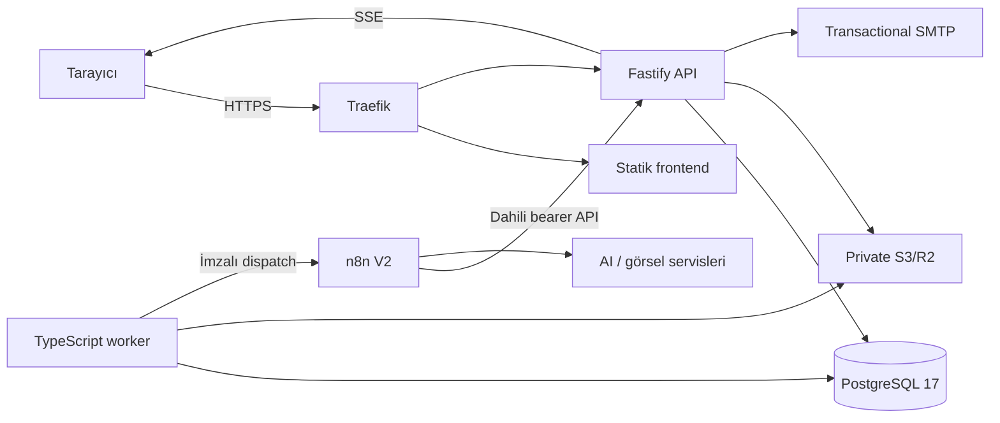

# VitrinOS Bağımsız Backend ve Self-Hosted Geçiş Planı

## 1. Amaç ve başarı ölçütleri

Bu belgenin amacı VitrinOS'u Supabase ve Vercel bağımlılıklarından çıkararak frontend, API, worker ve PostgreSQL katmanlarını mevcut Ubuntu sunucusunda çalıştırmak; n8n'i yalnızca yapay zekâ ve görsel üretim orkestrasyonu için korumaktır.

Geçiş tamamlandığında:

- Tarayıcı kodunda, API'de ve n8n akışlarında Supabase istemcisi, URL'si, anahtarı, Storage veya Data API çağrısı kalmayacak.
- Frontend ve API aynı alan adı üzerinden Traefik arkasında HTTPS ile yayınlanacak.
- Kimlik doğrulama, MFA, yetkilendirme, iş yönetimi, dosya erişimi ve denetim kayıtları VitrinOS backendinin sorumluluğunda olacak.
- İş verileri, kullanıcı kimlikleri ve gerekli dosyalar UUID'leri korunarak taşınacak. Parolalar taşınmayacak; kullanıcılar parola yenileyecek ve yönetici MFA'yı yeniden kuracak.
- n8n PostgreSQL'e veya nesne depolamaya doğrudan erişmeyecek; yalnızca sınırlandırılmış dahili API sözleşmesini kullanacak.
- Kısa ve kontrollü bakım penceresiyle geçiş yapılacak; doğrulama başarısız olursa Supabase'e geri dönüş mümkün olacak.

## 2. Doğrulanmış mevcut durum

### Yerel proje

- Frontend saf HTML, CSS ve JavaScript'tir; bu yapı korunacaktır.
- Yedi HTML sayfası Supabase CDN istemcisini yüklemektedir.
- Tarayıcı kodu Supabase Auth/MFA, Data API, Storage ve Realtime kullanmaktadır.
- `supabase/` altında 33 migration ve 6 Edge Function vardır: `submit-lead`, `trigger-brief`, `admin-user-actions`, `job-actions`, `upload-source-image`, `storage-cleanup-worker`.
- Mevcut test kapısı 22/22 başarılıdır. Yeni backend uygulanırken bu testler geçiş regresyon tabanı olarak korunacaktır.

### Supabase

- PostgreSQL 17.6 üzerinde 7 public iş tablosu ve özel cleanup kuyruğu vardır; RLS aktiftir.
- Veriler küçüktür: 1 marka, 1 marka promptu, 2 lead, 2 kullanıcı, 2 lead denemesi ve 5 audit kaydı; henüz job yoktur.
- İki private `generated-assets` nesnesi vardır; ayrıca iki yetim nesne tespit edilmiştir. Yetim nesneler otomatik silinmeyecek, 30 gün `migration-quarantine/` altında tutulacaktır.
- İki onaylı kullanıcıdan biri yöneticidir. Bir doğrulanmış TOTP faktörü vardır. Parola hashleri ve TOTP sırrı taşınmayacaktır.
- Realtime yalnızca `brands` ve `jobs` için kullanılmaktadır.

### Sunucu

- Ubuntu 22.04, x86_64, 2 vCPU, 7.8 GiB RAM ve yaklaşık 78 GB boş disk vardır.
- Docker, Traefik ve n8n aktiftir. UFW yalnızca 22/80/443 portlarını açmaktadır.
- SSH yalnızca anahtar ile, root girişi kapalı ve `locko-admin` kullanıcısıyla sınırlandırılmıştır; Fail2ban aktiftir.
- Chatwoot kapalı kalacaktır. Chatwoot PostgreSQL/Redis volume'ları ve ağı VitrinOS tarafından kullanılmayacaktır.
- Mevcut `edge_proxy` Traefik ağına yalnızca yayınlanması gereken servisler bağlanacaktır.

### n8n

- 5 aktif workflow ve 99 node vardır: BASE, META_POST, STORY, BANNER ve REVIZE.
- Toplam 18 Supabase bağımlılığı vardır. BASE içinde 11 veritabanı ve 3 Storage node'u; alt akışların her birinde 1 Storage node'u bulunmaktadır.
- Uzun ömürlü webhook sırrı geçmiş execution/pin verisinde açık metin olarak görülmüştür. Bu sır P0 güvenlik olayı kabul edilip geçersiz kılınacaktır.
- Canlı çalışma kanıtı sınırlıdır; STORY ve REVIZE için başarılı üretim kanıtı yoktur. V2 akışları paralel test edilmeden eski akışlar kapatılmayacaktır.

## 3. Hedef teknoloji kararı

| Katman | Teknoloji | Kullanım gerekçesi |
|---|---|---|
| Frontend | Vanilla HTML, CSS, JavaScript | Mevcut yapı korunur; framework dönüşüm riski ve kaynak tüketimi oluşmaz. |
| API | TypeScript, Node.js 24 LTS, Fastify 5 | Mevcut JavaScript bilgisiyle ortak dil, güçlü tip güvenliği, düşük bellek yükü ve yüksek istek performansı sağlar. |
| Worker | TypeScript, Node.js 24 LTS | API ile aynı domain tiplerini ve doğrulama şemalarını paylaşır; cleanup, e-posta ve dispatch görevlerini işler. |
| Veritabanı | PostgreSQL 17 | Mevcut Supabase şemasının doğal hedefidir; transaction, JSONB, indeks, locking ve `LISTEN/NOTIFY` sağlar. |
| SQL erişimi | Drizzle ORM + parametrik SQL | Migration ve tip güvenliği sağlar; kritik sorgularda SQL görünürlüğünü korur. |
| Doğrulama | Zod | HTTP gövdeleri, ortam değişkenleri ve n8n sözleşmelerini çalışma anında doğrular. |
| Canlı güncelleme | SSE + PostgreSQL `LISTEN/NOTIFY` | Mevcut Realtime ihtiyacını düşük karmaşıklıkla karşılar; tek yönlü iş durumu yayınları için yeterlidir. |
| Dosya depolama | Harici S3/R2 uyumlu private bucket | Sunucu diskini medya yükünden ayırır; presigned URL ve yaşam döngüsü politikası sağlar. |
| E-posta | Harici transactional SMTP | Parola yenileme ve güvenlik bildirimlerinin teslim edilebilirliğini artırır. |
| Dağıtım | Docker Compose + Traefik | Mevcut sunucu düzenine uyar; servis izolasyonu, healthcheck ve kaynak limiti sağlar. |

İlk sürümde Python, NestJS, Redis/BullMQ, Kubernetes ve n8n'e doğrudan veritabanı erişimi eklenmeyecektir. Mevcut iş hacminde PostgreSQL tabanlı kuyruk ve ayrı worker yeterlidir.

## 4. Hedef mimari



Docker ağları:

- `edge_proxy`: Traefik, frontend ve API. PostgreSQL veya worker bu ağa bağlanmaz.
- `vitrinos_internal`: API, worker ve PostgreSQL. Dışarı port yayınlanmaz.
- `vitrinos_automation`: API, worker ve n8n arasındaki kontrollü trafik. n8n PostgreSQL ağına alınmaz.

## 5. Backend proje yapısı ve sorumlulukları

Önerilen monorepo düzeni:

```text
apps/
  api/       Fastify HTTP API, auth, SSE ve internal n8n uçları
  worker/    outbox, cleanup, e-posta ve n8n dispatch işleri
packages/
  db/        Drizzle şeması, migration ve repository katmanı
  contracts/ Zod API şemaları, ortak tipler ve hata kodları
  security/  parola, session, CSRF, TOTP ve imza yardımcıları
infra/
  compose/   production Docker Compose ve örnek ortam dosyası
  scripts/   migration, backup, restore ve smoke-test komutları
```

API yalnızca HTTP ve domain işlemlerini yürütür. Uzun süren üretim, cleanup ve e-posta işleri transaction içinde `outbox_jobs` tablosuna yazılır; worker bunları `FOR UPDATE SKIP LOCKED` ile alır. Her iş sınırlı tekrar sayısı, artan gecikme, `locked_at`, `locked_by`, `attempt_count` ve son hata alanlarına sahip olur.

## 6. Veritabanı tasarımı

Tüm uygulama tabloları `app` şemasında tutulacak, sahiplik ayrı bir migration rolüne verilecek ve API en az yetkili çalışma rolü kullanacaktır.

Temel tablolar:

- `users`: mevcut kullanıcı UUID'si, e-posta, rol, durum ve zaman damgaları.
- `password_credentials`: Argon2id hash, parola değişim zamanı ve güvenlik sürümü.
- `auth_sessions`: hashlenmiş opaque session kimliği, kullanıcı, sona erme, iptal, son kullanım, IP özeti ve user-agent özeti.
- `mfa_factors` ve `mfa_recovery_codes`: şifreli TOTP sırrı ve tek kullanımlık hashlenmiş kurtarma kodları.
- `one_time_tokens`: parola kurma/yenileme ve e-posta doğrulama token hashleri; amaç, son kullanım ve sona erme bilgisi.
- `brands` ve `brand_prompts`: marka ayarları, kullanıcı sahipliği, prompt sürümü ve aktiflik.
- `jobs`, `job_attempts`, `job_events`: üretim işinin güncel durumu, her deneme ve append-only olay geçmişi.
- `assets`: nesne anahtarı, bucket, sahiplik, MIME, boyut, checksum, amaç ve yaşam döngüsü durumu.
- `leads` ve `lead_attempts`: form verisi, işleme durumu, tekrar ve son hata.
- `audit_logs`: aktör, eylem, hedef, sonuç, correlation ID ve güvenli metadata.
- `storage_cleanup_queue`: nesne silme talebi, tekrar sayısı, kilit ve son hata.
- `outbox_jobs`: transaction ile oluşturulan e-posta, n8n dispatch ve bakım görevleri.

Kurallar:

- UUID'ler veri taşınırken korunur; yeni kimlikler UUIDv7 veya PostgreSQL'in desteklediği güvenli UUID üretimiyle oluşturulur.
- E-posta normalize edilir ve case-insensitive unique indeksle korunur.
- Tüm foreign key sütunları, iş listelerinin `(owner_id, created_at, id)` alanları ve kuyrukların `(status, available_at)` alanları indekslenir.
- Sayfalama offset yerine kararlı cursor `(created_at, id)` ile yapılır.
- Durum geçişleri tek transaction içinde koşullu `UPDATE` ve olay ekleme ile gerçekleşir.
- Silme işlemleri varlık türüne göre soft-delete veya cleanup outbox ile yapılır; aktif dosya kaydı ile fiziksel nesne silme aynı HTTP transaction'ında yapılmaz.

## 7. Kimlik doğrulama ve güvenlik

- Parolalar Argon2id ile en az `m=19456 KiB`, `t=2`, `p=1` parametrelerinde hashlenir; üretimde benchmark sonrası yalnızca daha güçlü değerlere yükseltilebilir.
- Oturum, tarayıcıya `Secure`, `HttpOnly`, `SameSite=Lax`, dar `Path` ve uygun domain ayarlı opaque cookie ile verilir. Token `localStorage` içine yazılmaz.
- State-changing isteklerde Origin/Referer kontrolü ve double-submit CSRF token uygulanır.
- Giriş, parola yenileme, MFA ve public lead uçlarında IP + hesap tabanlı rate limit vardır; limit durumu PostgreSQL'de tutulabilir.
- TOTP sırları uygulama anahtarıyla AES-256-GCM kullanılarak şifrelenir. Anahtar veritabanında tutulmaz; Docker secret/env üzerinden sağlanır.
- Yönetici uçları hem rol hem de güncel MFA doğrulaması gerektirir. Kritik eylemler audit kaydı üretir.
- Parola yenileme tokenları rastgele, tek kullanımlık, kısa ömürlü ve veritabanında yalnızca hash olarak tutulur.
- Dosya yüklemede izin verilen MIME, uzantı, magic-byte, boyut, sahiplik ve checksum doğrulanır. Bucket private kalır; kısa ömürlü presigned URL üretilir.
- API hata yanıtları iç detay veya secret sızdırmaz; bütün isteklerde correlation ID bulunur.
- CSP'den Supabase/Vercel kaynakları çıkarılır; yalnızca gerekli aynı-origin, S3 ve güvenilir sağlayıcılar tanımlanır.

## 8. HTTP API sözleşmesi

Tüm uçlar `/api/v1` altında JSON kullanır. Başarılı cevaplarda `data`, hatalarda kararlı `code`, kullanıcı mesajı ve `correlationId` bulunur.

### Kimlik doğrulama

- `POST /auth/login`: e-posta/parola doğrular; MFA gerekirse kısa ömürlü challenge döndürür, aksi halde session cookie kurar.
- `POST /auth/mfa/verify`: challenge ve TOTP/kurtarma kodunu doğrular, tam session oluşturur.
- `POST /auth/logout`: mevcut session'ı iptal eder ve cookie'yi temizler.
- `GET /auth/session`: güvenli kullanıcı, rol ve MFA durumunu döndürür.
- `POST /auth/password/forgot`: hesap varlığını açığa çıkarmayan yanıtla e-posta işi oluşturur.
- `POST /auth/password/reset`: tek kullanımlık token ile yeni parola belirler ve eski session'ları iptal eder.
- `POST /auth/password/activate`: taşınmış kullanıcıların ilk parolasını belirler.
- `POST /auth/mfa/enroll`, `POST /auth/mfa/confirm`, `DELETE /auth/mfa`: yönetici MFA yaşam döngüsü.

### Uygulama

- `GET/POST/PATCH/DELETE /brands`: sahiplik ve rol kontrollü marka yönetimi.
- `GET/PUT /brands/:brandId/prompt`: prompt okuma ve sürümlü güncelleme.
- `POST /assets/upload-url`: doğrulanmış metadata için kısa ömürlü yükleme URL'si.
- `POST /assets/:assetId/complete`: checksum/metadata doğrulaması sonrası asset'i kullanıma açar.
- `POST /jobs`: idempotency key ile üretim işi ve ilk attempt'i atomik oluşturur.
- `GET /jobs` ve `GET /jobs/:jobId`: cursor sayfalama ve sahiplik kontrolü.
- `POST /jobs/:jobId/retry`: yalnızca tekrar edilebilir son durumda yeni attempt oluşturur.
- `POST /jobs/:jobId/cancel`: izin verilen durumlarda koşullu iptal.
- `GET /events/jobs`: yetkili kullanıcının iş olaylarını SSE ile yayınlar; `Last-Event-ID` ile kaçırılan olaylar tamamlanır.
- `POST /leads`: public form; honeypot, rate limit ve input doğrulamasıyla lead/outbox oluşturur.

### Yönetim

- `GET /admin/users`, `PATCH /admin/users/:id/status`, `PATCH /admin/users/:id/role`.
- `POST /admin/users/:id/password-reset` ve `POST /admin/users/:id/sessions/revoke`.
- `GET /admin/audit-logs`: cursor, tarih, aktör ve eylem filtreleri.

### n8n dahili sözleşmesi

- `POST /internal/v1/n8n/attempts/:attemptId/claim`: attempt'i atomik sahiplenir ve güvenilir üretim bağlamını döndürür.
- `GET /internal/v1/n8n/assets/:assetId/content`: yetki doğrulayıp kısa ömürlü indirme veya kontrollü stream sağlar.
- `PUT /internal/v1/n8n/attempts/:attemptId/result`: sonuç metadata/checksum gönderir; aynı checksum idempotent başarı, farklı checksum `409` üretir.
- `POST /internal/v1/n8n/attempts/:attemptId/fail`: güvenli hata sınıfı ve tekrar edilebilirlik bilgisini kaydeder.
- `POST /internal/v1/n8n/executions/:executionId/fail`: workflow seviyesindeki beklenmeyen hatayı correlation ID ile bildirir.

Dispatch gövdesi yalnızca `schemaVersion`, `eventId`, `attemptId`, `jobId`, `operation` ve `correlationId` içerir. Marka promptu, kullanıcı verisi veya storage anahtarı webhook gövdesine güvenilir kaynak olarak konmaz; n8n bunları `claim` ucundan alır.

## 9. İş durum makinesi ve idempotency

Ana durumlar: `queued -> dispatching -> processing -> succeeded | failed_retryable | failed_terminal | cancelled`.

- Her istemci job oluşturma isteği `Idempotency-Key` taşır. Aynı kullanıcı + anahtar + aynı istek hash'i önceki sonucu döndürür; farklı gövde `409` üretir.
- Worker dispatch sırasında attempt'i kilitler, event ID üretir ve n8n webhook'una zaman damgalı HMAC ile gider.
- n8n, attempt'i `claim` etmeden üretime başlamaz. Aynı attempt ikinci kez claim edilirse mevcut sahiplik/sonuç döner.
- Başarı sonucu `attemptId + output checksum` ile idempotenttir.
- Retry yalnızca allowlist hata sınıflarında ve sınırlı sayıda yapılır; terminal hata otomatik tekrar edilmez.
- Her geçiş `job_events` ve gerekli olduğunda `audit_logs` kaydı üretir.

## 10. n8n V2 geçişi

### P0 güvenlik işlemleri

1. Açığa çıktığı tespit edilen `x-vitrinos-webhook-secret` hemen döndürülür ve eski değer geçersiz kılınır.
2. Static header secret ile gelen dış webhook modeli kaldırılır.
3. Worker -> n8n çağrısı private Docker ağı üzerinden zaman damgası, canonical body hash ve HMAC imzasıyla yapılır; kısa replay penceresi ve event ID tekilliği doğrulanır.
4. n8n -> API çağrıları için ayrı, dar yetkili internal bearer credential n8n Credentials içinde tutulur.
5. Pin ve execution verilerindeki secret temizliği yedek ve açık kullanıcı onayıyla yapılır; execution saklama süresi düşürülür ve başarılı payload saklama en aza indirilir.

### Workflow dönüşümü

- Aktif akışlar doğrudan düzenlenmez; BASE_V2, META_POST_V2, STORY_V2, BANNER_V2 ve REVIZE_V2 klonları n8n arayüzünde manuel oluşturulur.
- Tüm Supabase DB ve Storage node'ları kaldırılır; yalnızca doğrulanmış HTTP Request node'larıyla internal API kullanılır.
- BASE_V2 gelen imzayı doğrular, `claim` çağrısı yapar ve ilgili alt akışı çağırır.
- Alt akışlar güvenilir claim bağlamıyla AI sağlayıcılarını çağırır; çıktı dosyasını backendin verdiği kontrollü upload akışıyla kaydeder ve sonucu bildirir.
- Hardcoded `HEPSIBURADA` değerleri kaldırılır; marka ve prompt her zaman claim yanıtından gelir.
- REVIZE içindeki mükerrer görsel indirme kaldırılır.
- Yapısal AI çıktısı şema ile doğrulanır; parser hataları bounded retry sonrası terminal/tekrar edilebilir sınıfa ayrılır.
- Tek bir Error Trigger workflow'u güvenli hata özetini internal failure ucuna gönderir; secret veya tam prompt loglamaz.
- Workflow değişiklikleri MCP ile doğrudan yayınlanmaz; n8n arayüzünde manuel uygulanır, validation ve test execution sonuçları kaydedilir.

## 11. Frontend dönüşümü

- Supabase CDN scriptleri, runtime Supabase config'i ve istemci başlatma kodu kaldırılır.
- Ortak `api-client`, `auth-store`, CSRF ve hata eşleme modülleri oluşturulur.
- Auth ekranları `/api/v1/auth/*` cookie tabanlı akışa geçirilir; parola aktivasyonu ve MFA yeniden kayıt ekranları eklenir.
- Marka, prompt, job, lead ve admin işlemleri yeni REST uçlarına geçirilir.
- Supabase Realtime abonelikleri SSE istemcisiyle değiştirilir; kopma halinde `Last-Event-ID`, exponential backoff ve sayfa görünürlüğü kontrolü kullanılır.
- Storage public/signed URL çağrıları backend asset uçlarına geçirilir.
- `vercel.json` yerine Traefik/static-server güvenlik başlıkları kullanılır; Vercel runtime config kaldırılır.
- Kullanıcıya gösterilen hata metinleri backend hata kodlarından güvenli ve yerelleştirilmiş mesajlara çevrilir.

## 12. Sunucu dağıtımı ve kaynak sınırları

İlk üretim limitleri:

| Servis | Bellek | CPU | Not |
|---|---:|---:|---|
| frontend | 128 MB | 0.10 | Statik dosya servisi |
| api | 768 MB | 0.75 | En az 2 Node worker değil; tek process, healthcheck |
| worker | 512 MB | 0.50 | Kontrollü concurrency |
| postgres | 1.5 GB | 1.00 | Kalıcı volume ve düzenli backup |

- PostgreSQL, worker ve internal API portları hosta açılmaz.
- Traefik yalnızca frontend ve public API route'larını yayınlar; `/internal/` router üzerinden erişilemez.
- Container'lar non-root, read-only filesystem ve gerekli tmpfs/volume'larla çalışır; capability'ler düşürülür.
- `/health/live` process canlılığını, `/health/ready` DB ve zorunlu bağımlılıkları kontrol eder.
- Secret'lar repoya veya Compose dosyasına yazılmaz; `.env.example` yalnızca adları ve açıklamaları içerir.
- Loglar JSON, correlation ID içeren, boyut/süre ile rotate edilen ve kişisel veri/secret redaction uygulanan yapıda tutulur.
- Chatwoot servisleri, volume'ları ve ağı yeniden kullanılmaz; kapalı kalır.

## 13. Veri ve dosya taşıma stratejisi

1. Migration öncesi Supabase PostgreSQL dump'ı, tablo sayımları, kullanıcı/asset manifesti ve S3 hedef bağlantısı doğrulanır.
2. Yeni PostgreSQL migration'ları boş veritabanına uygulanır; kısıtlar ve indeksler hazırlanır.
3. Business tabloları UUID ve zaman damgaları korunarak sıralı transaction'larla içe alınır.
4. Auth kullanıcıları yalnızca kimlik, e-posta, rol ve durumla oluşturulur. Supabase parola hashleri, session/refresh tokenları ve TOTP sırrı aktarılmaz.
5. Her kullanıcı için tek kullanımlık parola aktivasyon tokenı üretilir; yalnızca hash saklanır ve SMTP üzerinden bağlantı gönderilir.
6. Yönetici ilk girişte parola belirler ve MFA'yı yeniden kaydetmeden yönetim işlevlerine erişemez.
7. Private bucket nesneleri checksum doğrulamasıyla S3/R2'ye kopyalanır; başarılı kopyalar manifestte işaretlenir.
8. İki yetim nesne `migration-quarantine/` prefix'ine alınır, 30 gün korunur ve otomatik olarak aktif asset tablosuna bağlanmaz.
9. Kaynak/hedef tablo sayımları, UUID kümeleri, foreign key bütünlüğü, checksum ve örnek iş akışları karşılaştırılır.
10. Supabase proje ve dosyaları geçiş günü silinmez; rollback süresi boyunca salt okunur referans olarak korunur.

## 14. Uygulama sırası

### Faz 0 — Güvenlik ve temel kararların kilitlenmesi [TAMAMLANDI]

- [x] n8n webhook sırrını döndür, eski değeri geçersiz kıl ve kayıt saklama politikasını daralt.
- [x] Domain, SMTP ve S3/R2 sağlayıcı bilgilerini secret envanterine ekle.
- [x] Supabase ve n8n'in güncel şema/workflow envanterini tarihli migration manifestine kaydet.

### Faz 1 — İskelet ve yerel geliştirme [TAMAMLANDI]

- [x] TypeScript monorepo, Fastify API, worker, ortak contract ve DB paketlerini kur.
- [x] Ortam doğrulaması, structured logging, error envelope, healthcheck ve test altyapısını ekle.
- [x] Docker Compose ile izole PostgreSQL ve yerel S3 uyumlu test servisi kullan; üretim secret'ı ekleme.


### Faz 2 — Veritabanı ve domain katmanı [TAMAMLANDI]

- [x] `app` şemasını, migration'ları, indeksleri, roller ve repository katmanını oluştur.
- [x] Job durum makinesi, outbox locking, idempotency ve audit işlemlerini transaction testleriyle tamamla.

### Faz 3 — Auth ve yönetim [TAMAMLANDI]

- [x] Parola, session, CSRF, rate limit, parola aktivasyonu/yenileme ve MFA akışlarını uygula.
- [x] Rol matrisi ile kullanıcı ve audit yönetim uçlarını tamamla.

### Faz 4 — Uygulama API'leri ve Storage

- Marka, prompt, job, asset ve lead uçlarını Edge Function davranışlarıyla eşdeğer hale getir.
- S3/R2 presigned upload/download, checksum ve cleanup kuyruğunu uygula.
- SSE job event yayını ve yeniden bağlanma semantiğini tamamla.

### Faz 5 — n8n V2

- Dahili API credential'larını oluştur; V2 workflow'ları n8n arayüzünde klonla.
- Supabase node'larını HTTP internal API ile değiştir; ortak hata workflow'unu bağla.
- Her içerik türü, revizyon, timeout, duplicate callback ve sağlayıcı hata senaryosunu test et.

### Faz 6 — Frontend

- Sayfaları sırayla auth, dashboard/jobs, brand/prompt, assets, lead ve admin API'lerine geçir.
- Realtime yerine SSE ve storage yerine asset sözleşmesini devreye al.
- Supabase/Vercel script, config ve CSP izinlerini kaldır.

### Faz 7 — Staging ve prova migration

- Anonimleştirilmiş veya erişimi sınırlandırılmış snapshot ile tam migration provası yap.
- Süreyi ölç, manifest karşılaştırmasını ve rollback adımlarını tekrar et.
- Güvenlik, yük, tarayıcı ve n8n uçtan uca kapılarını geçir.

### Faz 8 — Üretim geçişi

- Bakım sayfasını aç ve Supabase'e yeni yazımları durdur.
- Final dump ve asset delta kopyasını al; migration ve doğrulamaları çalıştır.
- DNS/Traefik route'unu yeni frontend/API'ye geçir; V2 workflow'ları etkinleştir.
- Smoke test sonrası bakım sayfasını kapat; eski workflow'ları pasif fakat rollback süresince sakla.

### Faz 9 — Stabilizasyon ve Supabase'i kaldırma

- Hata oranı, job süreleri, DB bağlantıları, disk, backup ve SMTP teslimatını yakından izle.
- Rollback süresi ve veri mutabakatı tamamlanınca Supabase anahtarlarını iptal et.
- Supabase kodu/migration arşivini ayrı etiketle koru; runtime bağımlılıklarını projeden kaldır.

## 15. Test ve kabul planı

### Otomatik testler

- Unit: Zod şemaları, parola, token, CSRF, TOTP, HMAC, hata eşleme ve durum geçişleri.
- Integration: gerçek PostgreSQL ile transaction, unique constraint, locking, outbox retry, idempotency ve cursor sayfalama.
- API: auth cookie özellikleri, rol/sahiplik, rate limit, dosya doğrulama ve internal endpoint yetkileri.
- Contract: worker -> n8n dispatch ve n8n -> API örnek payload'ları; eksik/fazla alan, eski şema sürümü ve duplicate callback.
- Storage: presigned URL süresi, MIME/magic-byte uyumsuzluğu, checksum, yetkisiz erişim ve cleanup retry.
- SSE: reconnect, `Last-Event-ID`, olay sırası ve erişim izolasyonu.
- Migration: tablo sayısı, UUID, foreign key, audit, asset manifest/checksum ve parola aktivasyonu.

### Uçtan uca senaryolar

- Taşınmış normal kullanıcı parola oluşturur, giriş yapar, marka verisini görür ve başka kullanıcının verisine erişemez.
- Yönetici parola oluşturur, MFA kaydeder ve MFA olmadan yönetim eylemi yapamaz.
- Kullanıcı kaynak görsel yükler, iş oluşturur, n8n sonucu üretir ve SSE üzerinden başarı durumunu görür.
- Aynı job isteği iki kez gönderildiğinde yalnızca bir iş oluşur.
- n8n aynı sonucu iki kez gönderdiğinde ikinci çağrı yan etki oluşturmadan başarılı olur; farklı checksum `409` döner.
- AI sağlayıcısı timeout olduğunda bounded retry çalışır; terminal hatada sonsuz döngü oluşmaz.
- Public lead spam/rate-limit kontrollerinden geçer ve backend dış detay sızdırmaz.
- S3, SMTP veya n8n geçici olarak kapalıyken veri kaybı olmaz; outbox tekrar eder ve operasyon görünür kalır.

### Üretime çıkış kapıları

- Eski 22 test dahil tüm testler başarılıdır.
- Kritik/yüksek güvenlik bulgusu yoktur; internal endpoint dışarıdan erişilemez.
- Prova migration'ı öngörülen bakım penceresine sığar ve mutabakat sıfır farkla tamamlanır.
- BASE_V2, META_POST_V2, STORY_V2, BANNER_V2 ve REVIZE_V2 için başarılı ve hatalı execution kanıtı vardır.
- Backup alınmış ve ayrı geçici veritabanına restore testi başarıyla yapılmıştır.

## 16. İzleme, yedekleme ve bakım

- Ölçümler: istek sayısı/gecikme/hata, aktif DB bağlantısı, slow query, outbox derinliği/yaşı, job süreleri, n8n callback hataları, SMTP ve storage hataları.
- Alarm eşikleri başlangıçta düşük tutulur; 5xx artışı, 10 dakikayı aşan en eski outbox işi, disk %80, backup başarısızlığı ve sürekli restart alarm üretir.
- PostgreSQL için günlük 7, haftalık 4 ve aylık 6 şifreli backup tutulur; kopyalardan biri sunucu dışında saklanır.
- S3 versioning/lifecycle etkinleştirilir. Aylık restore tatbikatı yapılır ve RPO/RTO kaydedilir.
- Migration'lar ileri yönlü ve sıralıdır; destructive migration ayrı sürüm ve doğrulanmış backup gerektirir.

## 17. Rollback planı

- DNS TTL geçişten önce düşürülür; eski Supabase/Vercel yapılandırması rollback süresi boyunca değiştirilmeden saklanır.
- Cutover sonrası kritik hata görülürse bakım modu açılır ve yeni sisteme yazım durdurulur.
- Eski route ve n8n V1 workflow'ları yeniden etkinleştirilir.
- Yeni sistemde oluşmuş veriler audit/outbox manifestinden dışa aktarılır; otomatik çift yönlü birleştirme yapılmaz. Rollback kararı mümkün olan en kısa gözlem penceresinde verilir.
- Supabase anahtarları ancak stabilizasyon ve rollback süresi tamamlandıktan sonra iptal edilir; öncesinde proje silinmez.

## 18. Uygulama korumaları ve varsayımlar

- Frontend saf HTML/CSS/JS olarak kalacaktır.
- Frontend, API ve PostgreSQL aynı fiziksel sunucuda; nesne depolama ve SMTP harici yönetilen servislerde olacaktır.
- n8n korunacak fakat yalnızca AI/görsel orkestrasyonu yapacaktır.
- Chatwoot kapalı kalacak; kaynakları veya volume'ları yeniden kullanılmayacaktır.
- Kullanıcı iş verileri ve dosyalar korunacak; parola/session/TOTP sırları taşınmayacaktır.
- Yönetici dahil tüm kullanıcılar parola belirleyecek; yönetici MFA'yı yeniden kaydedecektir.
- Geçiş kısa bakım penceresinde yapılacaktır.
- Yetim iki dosya 30 günlük karantinaya alınacak ve açık onay olmadan silinmeyecektir.
- Secret temizliği, veri silme, workflow yayınlama ve üretim servislerini yeniden başlatma işlemleri ayrı açık onay gerektirir.
- Kullanıcıya ait mevcut Git değişiklikleri korunacak; özellikle silinmiş `docs/server-production-readiness-report.md` geri getirilmeyecek veya stage edilmeyecektir.

## 19. Diğer agent için ilk çalışma paketi

Uygulamaya başlayacak agent Faz 0, Faz 1, Faz 2 ve Faz 3'ü tamamlanmış olarak devralacaktır. Sıradaki çalışma paketi Faz 4 (Uygulama API'leri ve Storage) aşamasıdır:

1. Marka, prompt, job, asset ve lead uçlarını Edge Function davranışlarıyla eşdeğer hale getirecek şekilde Fastify API'ye geçir.
2. S3/R2 presigned upload/download URL üretimi, dosya checksum doğrulaması ve cleanup kuyruğunu entegre et.
3. SSE (Server-Sent Events) tabanlı job durum ve olay yayını ile yeniden bağlanma semantiğini tamamla.

Bu sıra değiştirilmemelidir: API katmanının temel veri/dosya akışları tamamlandıktan sonra n8n entegrasyonu (Faz 5) yapılmalıdır.

