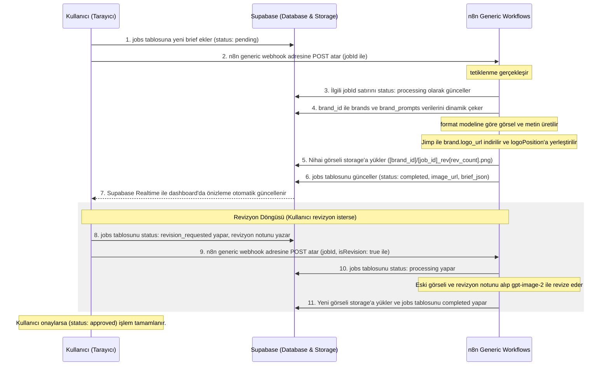

# VitrinOS SaaS Canlıya Alış & Geliştirme Planı

Bu plan, VitrinOS görsel otomasyon platformunu Hepsiburada özelindeki yerel Telegram yapısından çıkarıp; çoklu markayı destekleyen, Supabase veritabanı ve storage entegrasyonuna sahip, webhook tetiklemeli profesyonel bir SaaS ürünü haline getirmek için hazırlanmıştır.

## Referans Alınan Yetenek Kuralları
- [design-taste-frontend/RULES.md](file:///C:/Users/Mustafa/.gemini/antigravity/skills/design-taste-frontend/RULES.md)
- [redesign-existing-projects/RULES.md](file:///C:/Users/Mustafa/.gemini/antigravity/skills/redesign-existing-projects/RULES.md)

---

## 1. Mimari Tasarım ve Akış Şeması

Aşağıdaki şemada, dashboard üzerinden başlayan brief girişinin n8n generic orkestrasyonu ve Supabase entegrasyonu ile sonlanma döngüsü gösterilmiştir.

---

## 2. Planlanan Değişiklikler ve Görevler

Geliştirme süreci, belirlenen öncelik sırasına göre 4 ana adımdan oluşmaktadır.

### Adım 1: n8n Generic Workflow Mimarisi & Supabase Entegrasyonu (En Yüksek Öncelik)

Hepsiburada için yazılmış olan 5 adet n8n iş akışı (`VitrinOS_BASE`, `VitrinOS_BANNER`, `VitrinOS_STORY`, `VitrinOS_META_POST`, `VitrinOS_REVIZE`) analiz edilmiş ve generic hale getirilmesi için yapılacak düzenlemeler belirlenmiştir.

#### 1. VitrinOS_BASE (Ana Orkestratör) Düzenlemeleri
- **İfade Hatalarının Düzeltilmesi (Expression Errors):**
  - `Storage_Gorsel_Yukle` ve `Supabase_Isi_Tamamlandi_Guncelle` düğümlerindeki tanımsız `{{ $('Webhook_Trigger') }}` ifadesi, tetikleyici düğümün gerçek adı olan `{{ $('Brief_Tetikleyici') }}` ile güncellenecektir.
  - Revizyon akışındaki `Storage_Revize_Gorsel_Yukle` ve `Supabase_Revizyon_Tamamlandi_Guncelle` düğümlerinde bulunan tanımsız `{{ $node['Supabase_Get_Job_Details'] }}` ve `{{ $('Webhook_Trigger') }}` ifadeleri sırasıyla `{{ $node['Supabase_Is_Detaylarini_Getir'] }}` ve `{{ $('Brief_Tetikleyici') }}` ile değiştirilecektir.
- **Alt Akış Çağrılarının Güncellenmesi:**
  - `Call_VitrinOS_REVIZE` düğümünün `workflowInputs` parametrelerine `image_url` alanı eklenerek, `{{ $node['Supabase_Is_Detaylarini_Getir'].json.image_url }}` değeri alt akışa iletilecektir.
  - Tüm format çağrı düğümlerine (`Call_VitrinOS_BANNER`, `Call_VitrinOS_STORY`, `Call_VitrinOS_META_POST`) `brand` nesnesi `{{ $('Supabase_Marka_Bilgisi_Getir').item.json }}` parametresi olarak eklenecektir.

#### 2. VitrinOS_BANNER, VitrinOS_STORY ve VitrinOS_META_POST Düzenlemeleri
- **3'lü Prompt Yapısı Entegrasyonu:**
  - Her üç formatta da `Baslangic_Verilerini_Ayarla` düğümünde `brand` parametresi (`{{ $json.brand }}`) set edilecektir.
  - **Metin Üretimi:** `Banner_Metin_Olustur`, `Story_Metin_Olustur` ve `Instagram_Metin_Olustur` düğümlerinde sırasıyla veritabanındaki yeni `prompts.banner_text_prompt`, `prompts.story_text_prompt` ve `prompts.meta_post_text_prompt` kullanılacaktır.
  - **Arka Plan Üretimi:** `Arkaplan_Olustur` düğümlerinde sırasıyla veritabanındaki `prompts.banner_bg_prompt`, `prompts.story_bg_prompt` ve `prompts.meta_post_bg_prompt` kullanılacaktır.
  - **Nesne/Görsel Üretimi:** `Gorsel_Prompt_Olustur` düğümlerinde sırasıyla veritabanındaki `prompts.banner_img_prompt`, `prompts.story_img_prompt` ve `prompts.meta_post_img_prompt` kullanılacaktır.
- **Dinamik Logo ve Jimp Entegrasyonu:**
  - Jimp kodlarındaki sabit dosya isimleri (`hepsiburada-banner.png`, `hepsiburada-story.png`, `hepsiburada-post.png`) generic hale getirilecektir (Örn: `[brand_id]_format.png`).
  - `Story` ve `Meta Post` formatlarındaki Jimp kodunda yer alan `logoBuffer` bağımlılığı (hata veren `this.helpers.getBinaryDataBuffer(0, 'logo')`) kaldırılacak; logo doğrudan `brand.logo_url` üzerinden `Jimp.read(brand.logo_url)` ile indirilip, `logoPosition` koordinatlarına göre görsel üzerine dinamik yerleştirilecektir.
- **Marka Bağımlılıklarının Temizlenmesi:**
  - `Edit_Image_Prompt_Hazirla` düğümlerindeki statik "Hepsiburada", "Hepsiburada orange" gibi ifadeler temizlenerek `brand.name` ve `brand.color_palette` parametreleriyle dinamikleştirilecektir.

#### 3. VitrinOS_REVIZE (Görsel Revizyon) Düzenlemeleri
- **Telegram Bağımlılığının Kaldırılması:**
  - `Revize_Görsel_İndir` Telegram düğümü tamamen kaldırılacaktır.
  - Yerine `HTTP Request` düğümü eklenerek, `Baslangic_Verilerini_Ayarla` düğümüne `image_url` (eski görsel URL'i) parametresi alınacak ve bu URL üzerinden eski görsel indirilip OpenAI Edit düğümüne binary olarak aktarılacaktır.
- **Jimp Çözünürlük ve Marka Temizliği:**
  - `Orijinal_Cozunurluge_Cevir` düğümündeki Jimp kodunda yer alan sabit `hepsiburada-revize...` dosya ismi generic hale getirilecektir.
  - Revizyon prompt'u olarak `prompts.revize_prompt` kullanılacaktır.

---

---

### Adım 2: Dashboard ve Webhook Entegrasyonu

Canlı panel arayüzünün (`dashboard.html` ve [dashboard.js](file:///c:/Users/Mustafa/Desktop/VitrinOS/js/dashboard.js)) n8n generic webhook yapısıyla tam uyumlu çalışması sağlanacaktır.

**Yapılacak Düzenlemeler:**
1. **Brief Gönderme Akışı**:
   - [dashboard.js](file:///c:/Users/Mustafa/Desktop/VitrinOS/js/dashboard.js) içindeki HTTP POST isteği n8n generic webhook adresine yönlendirilecektir.
   - Gönderilen JSON veri modeli generic yapıya (`jobId`, `userId`, `brandId`, `briefText`, `format`) göre ayarlanacaktır.
2. **Revizyon Gönderme Akışı**:
   - Revizyon tetiklendiğinde `jobs` tablosu `revision_requested` olarak güncellenecek, revizyon notu kaydedilecek ve generic webhook `jobId`, `isRevision: true`, `revisionNote` ile tetiklenecektir.
3. **Supabase Realtime ve UI Güncellemeleri**:
   - `jobs` tablosunda durum `processing` olduğunda dashboard'da yükleniyor (loader) efekti gösterilecektir.
   - Durum `completed` olduğunda önizleme alanı, LLM'in `brief_json` kolonuna yazdığı başlık, caption, slogan ve storage'a yüklenen `image_url` görseliyle dinamik olarak doldurulacaktır.
   - "Onayla" tıklandığında `jobs` tablosu doğrudan `approved` olarak güncellenecek ve n8n tetiklenmeden iş arşive aktarılacaktır.

---

### Adım 3: Admin Paneli (Marka, Logo ve Prompt Yönetimi)

Admin kullanıcılarının (SaaS sahibi/yöneticisi) markaları ve markaya özel görsel otomasyon şablonlarını yönetebileceği alanlar tamamlanacaktır.

**Yapılacak Düzenlemeler:**
1. **Sistemsel Eksiklik Giderilmesi (users Tablosu)**:
   - [admin.js](file:///c:/Users/Mustafa/Desktop/VitrinOS/js/admin.js) içindeki `client.from('users').select('*')` sorgusu, Supabase `public` şemasında `users` tablosu bulunmadığı için hata verebilir. 
   - **Çözüm**: Supabase tarafında yeni bir `public.users` tablosu oluşturulacak ve `auth.users` tablosuna yeni üye eklendiğinde veya güncellendiğinde bu tabloyu güncel tutacak bir postgres trigger/function eklenecektir.
2. **Marka Ekleme & Düzenleme Ekranı**:
   - Admin panelinde yeni marka eklerken logo dosyasının doğrudan Supabase Storage'a (`brand-logos` bucket) yüklenmesi ve URL'sinin `brands.logo_url` alanına yazılması sağlanacaktır.
   - `color_palette` (JSON), `tone_rules` (text), `banned_words` (array) alanlarının form üzerinden girilebilmesi sağlanacaktır.
3. **Dinamik Prompt Şablonları Girişi**:
   - Her marka için `brand_prompts` tablosundaki `base_prompt`, `banner_prompt`, `meta_post_prompt`, `story_prompt` ve `revize_prompt` alanlarının admin panelinde düzenlenebilmesi sağlanacaktır.

---

### Adım 4: Landing Page & Lead Form Geliştirmesi (Pazarlama Aşaması)

VitrinOS ana sayfasının ([index.html](file:///c:/Users/Mustafa/Desktop/VitrinOS/index.html)) SaaS ürününe yakışır şekilde premium, modern ve anti-slop tasarım kurallarıyla revize edilmesi.

**Tasarım Kararları (RULES.md uyarınca):**
- **Tipografi**: Geist sans-serif font ailesi entegre edilecektir. Başlıklar ağır ve tınlayan (`text-5xl md:text-7xl tracking-tighter leading-none`) olarak ayarlanacaktır.
- **Renk Paleti (Cold Luxury)**: AI klişesi mor/mavi gradyanlar yerine koyu kömür tonları (`#0d0d0d`), gümüş gri ve tek bir premium marka rengi (Burnt Orange/Turuncu veya benzeri tek accent) kullanılacaktır.
- **Yerleşim**: Her şeyin ortalı olduğu klasik AI şablonları yerine asimetrik gridler ve ritmik bento kutuları kullanılacaktır. Bento kutuları içinde gerçek görsel/fotoğraf önizlemeleri yer alacaktır.
- **Lead Form**: Ziyaretçilerin ihtiyaçlarını ilettiği form Supabase `leads` tablosuna `status = 'new'` olarak güvenli bir şekilde kaydolacaktır. Form ve input contrast oranları WCAG AA (min 4.5:1) standartlarında olacaktır.

---

## 3. Doğrulama ve Test Planı

### Otomatik & Manuel Testler
1. **n8n Webhook Doğrulama**: Postman veya curl ile generic webhook HTTP POST atılarak `jobs` tablosundaki durum güncellemeleri (`processing` -> `completed`) kontrol edilecektir.
2. **Jimp Logo & Koordinat Testleri**: Farklı formatlar (Banner, Story, Post) için dinamik logo boyutlandırma ve koordinat yerleşimleri görsel olarak test edilecektir.
3. **Storage Upload Yetki Kontrolü**: RLS politikalarının n8n'den gelen storage yükleme isteklerine izin verdiği doğrulanacaktır.
4. **Realtime Dashboard Senkronizasyonu**: Supabase'deki `jobs` tablosu güncellendiğinde dashboard ekranının sayfa yenilenmeden güncellendiği test edilecektir.
5. **Form Kontrast ve Erişilebilirlik Audit'i**: Chrome Lighthouse ile form ve buton kontrast oranları doğrulanacaktır.
6. **İki Aşamalı Revizyon Limit Testi**: 3 revizyondan sonra generic akışın revizyon limit uyarısı verip durduğu kontrol edilecektir.
